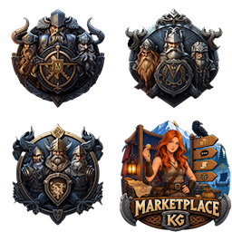
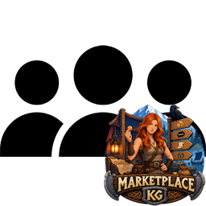
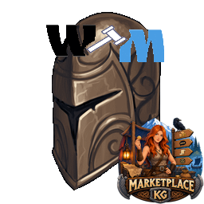

# Integrations

Marketplace can work together with other Valheim mods: a leveling mod can be paid out as a quest reward, a guild mod can lock a territory to its members, a party mod can share kill progress. Since 10.0.9 none of that is built into Marketplace itself. Every connection goes through a small public interface, the **Marketplace API**, and a separate mod called a **bridge** plugs a specific mod into it.

This section has two sides:

- **Running a server or playing:** install the [bridge](#bridges) for each mod you use. Nothing else changes.
- **Writing a mod:** [integrate your mod](your-mod.md) with Marketplace in a few lines, using the [API reference](api-reference.md) for every call and type.

## Bridges

A bridge is a BepInEx plugin that depends on Marketplace and on one other mod. It registers that mod's rewards, conditions, commands and chat commands under the same names Marketplace used before 10.0.9, so existing quest, dialogue and quest-event files keep working. Install only the bridges for the mods you use. Bridges run on the player's client, so install them wherever players run Marketplace.

| Bridge | For | What it adds | Download |
|---|---|---|---|
|  [Guilds](bridges/guilds.md) | [Guilds](https://thunderstore.io/c/valheim/p/Smoothbrain/Guilds/) | Guild-only territories, `/g`, guild conditions and commands | [Hexium](https://valheim.hexium.gg/mods/KG/Marketplace_Bridge_Guilds) |
|  [Groups](bridges/groups.md) | [Groups](https://thunderstore.io/c/valheim/p/Smoothbrain/Groups/) | Shared party kills, `/p` | [Hexium](https://valheim.hexium.gg/mods/KG/Marketplace_Bridge_Groups) |
|  [EpicMMO](bridges/epicmmo.md) | [EpicMMO](https://thunderstore.io/c/valheim/p/WackyMole/WackyEpicMMOSystem/) | Experience reward and command, level conditions | [Hexium](https://valheim.hexium.gg/mods/KG/Marketplace_Bridge_EpicMMO) |

Without the matching bridge, the names stop working: an unknown reward shows a red `Wrong reward 'name'` in the quest window and gives nothing, an unknown command is logged and does nothing, and an unknown condition always fails. See [Migrations](../reference/migrations.md#updating-to-1009-third-party-integrations-moved-to-bridge-mods) if you are updating from an older version.

## Writing your own

The API is open, so anyone can publish a bridge for another mod and the list above can grow. A bridge is an ordinary mod built on the same public interface. Start with [Integrate your mod](your-mod.md).

## Related

- [Integrate your mod](your-mod.md), [API reference](api-reference.md).
- [Territories](../configs/territories.md), [NPC system](../npc/npc-system.md).
